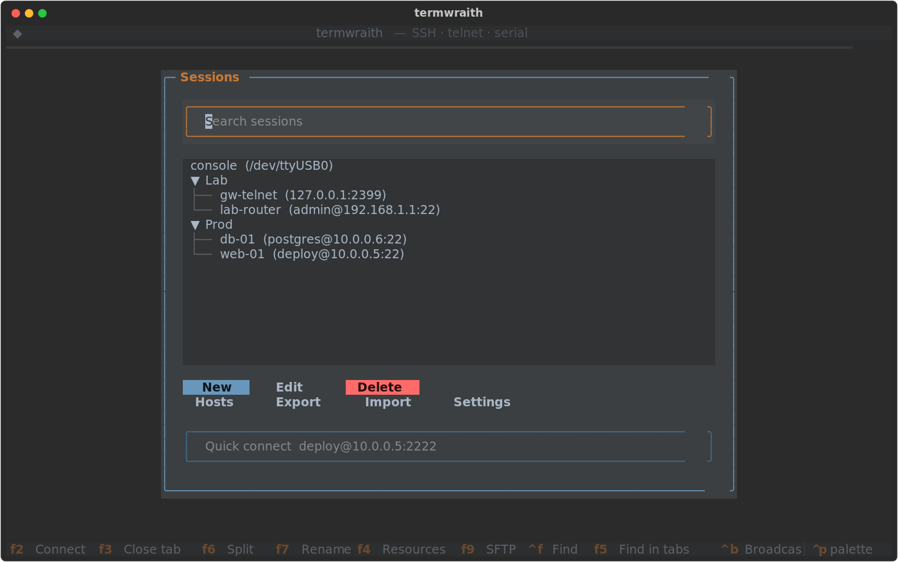
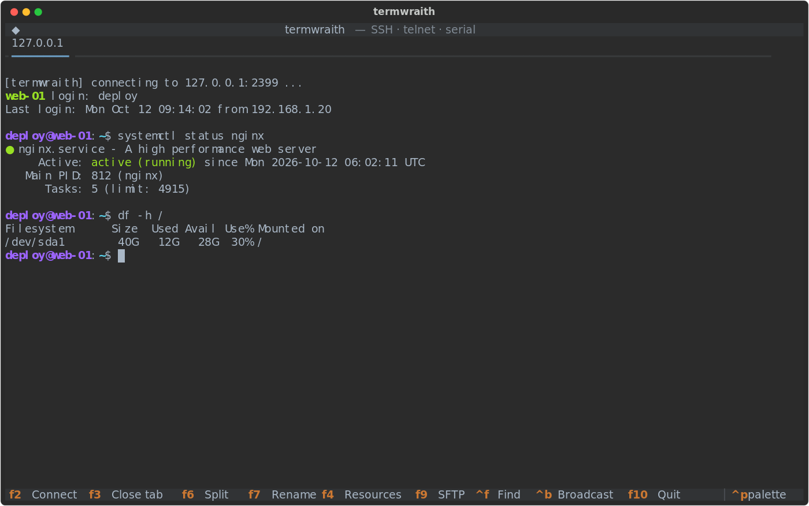
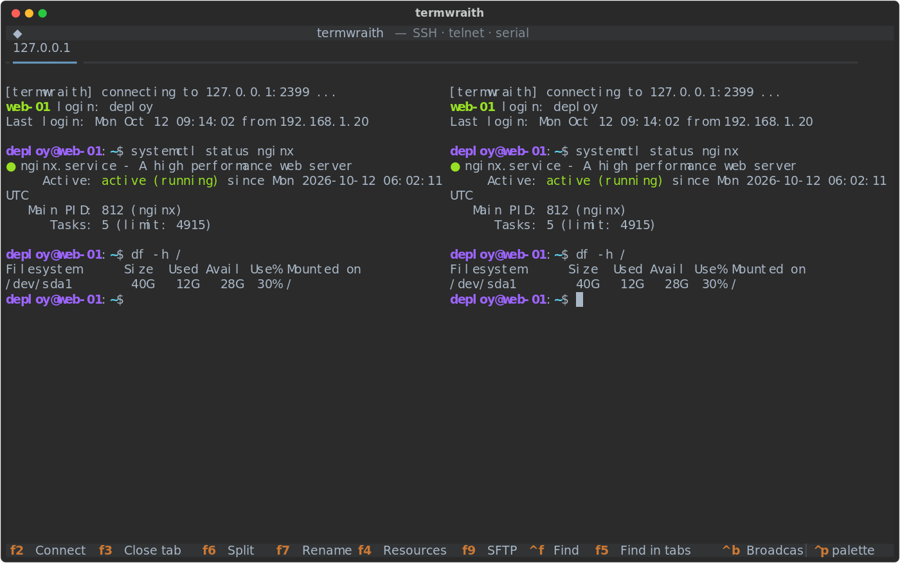
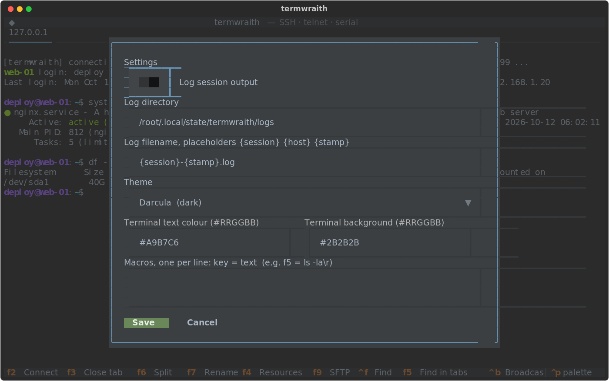

# termwraith

A SecureCRT-style terminal for SSH, telnet and serial, built on Textual.

## Screenshots

| Session picker | Session tab |
|---|---|
|  |  |

| Split pane (F6) | Settings |
|---|---|
|  |  |

## Install

Linux and macOS (needs git and Python 3.10+):

    curl -fsSL https://raw.githubusercontent.com/linkinxp/TermWraith/main/install.sh | sh

Windows (PowerShell, needs git and Python 3.10+):

    irm https://raw.githubusercontent.com/linkinxp/TermWraith/main/install.ps1 | iex

## Android (Termux)

Install Termux from F-Droid (the Play Store build is outdated), then run the same Linux command inside Termux. The installer uses `pkg` to add git and Python. Termux has no F-keys on its extra-keys bar by default, so use the Termux extra-keys row to send F2 to F10 when you need them.

## Update

Run the same install command again. It pulls the latest code and reinstalls.

## Run

    termwraith

## Import from SecureCRT

In the session picker, press Import and give a path to either:

- the SecureCRT `Sessions` folder (`%APPDATA%\VanDyke\Config\Sessions`), or one of its `.ini` files
- a `.reg` export of `HKEY_CURRENT_USER\Software\VanDyke\SecureCRT\Sessions`
- SecureCRT's `Global.ini` (`%APPDATA%\VanDyke\Config`) to import the command-window colour scheme and the logging switch

Folders, hosts, ports, usernames, key paths, serial ports and baud rates are imported; the `Default` session fills in missing values. Each session also keeps its SecureCRT colour scheme name, scrollback length and auto-reconnect setting. Saved passwords are encrypted by SecureCRT and are not imported; re-enter them in termwraith. From `Global.ini` the colour schemes (so imported sessions can use them), the command-window colours and the logging switch carry over; other SecureCRT settings have no termwraith equivalent yet.

## Logs

Set the log directory and filename template in Settings. The template accepts `{session}`, `{host}` and `{stamp}` (timestamp), for example `{host}_{session}_{stamp}.log`. Unsafe characters are replaced with `_`.

## Themes

Settings offers the built-in Textual themes plus the t-ui palettes from [M4dGun/t-ui_themes](https://github.com/M4dGun/t-ui_themes) (GPL-3.0): Dracula v1 and v2, NetHunter v1 and v2, GRID, T-ui Dev 2 and 2.3, Girls Frontline UMP45 and M4A1, Koban, WallX, Tomboy Girl, Mellogram, Arch Neofetch, Arch NeoNight, Archer, Clean-tui, Cosmic, Hunting Dracula, Tokyo Night and VRAM. Their colours are mapped to the nearest Textual theme fields, so they are close to the originals rather than exact copies.

## Keys

- F2 connect, F3 close tab, F4 remote resources (SSH), F6 split pane, F7 rename tab
- F5 find text in all open tabs (pick a hit to jump to its tab), F8 next search match, Ctrl+F search, Ctrl+B broadcast to all panes
- Quick connect: Up/Down recalls the last 10 targets typed in the picker
- Picker: the search box above the session list filters by name, host, user, folder or protocol
- Forwards: L:local:host:remote, R:remote:host:local, D:port (SOCKS5 proxy, SSH)
- F9 SFTP browser (SSH), Ctrl+PgUp/PgDn cycle tabs, Shift+PgUp/PgDn scroll, F10 quit
